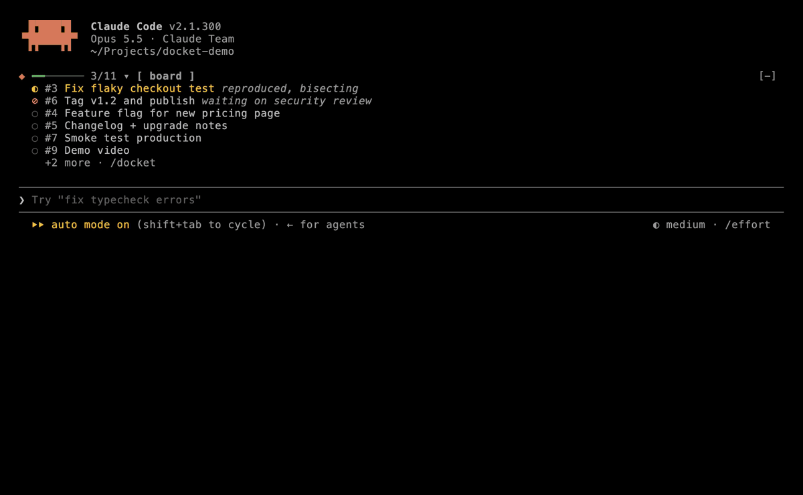
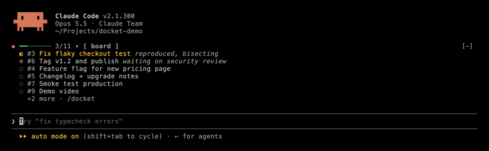
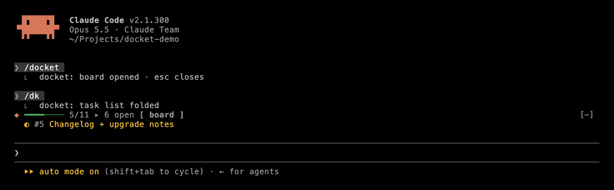
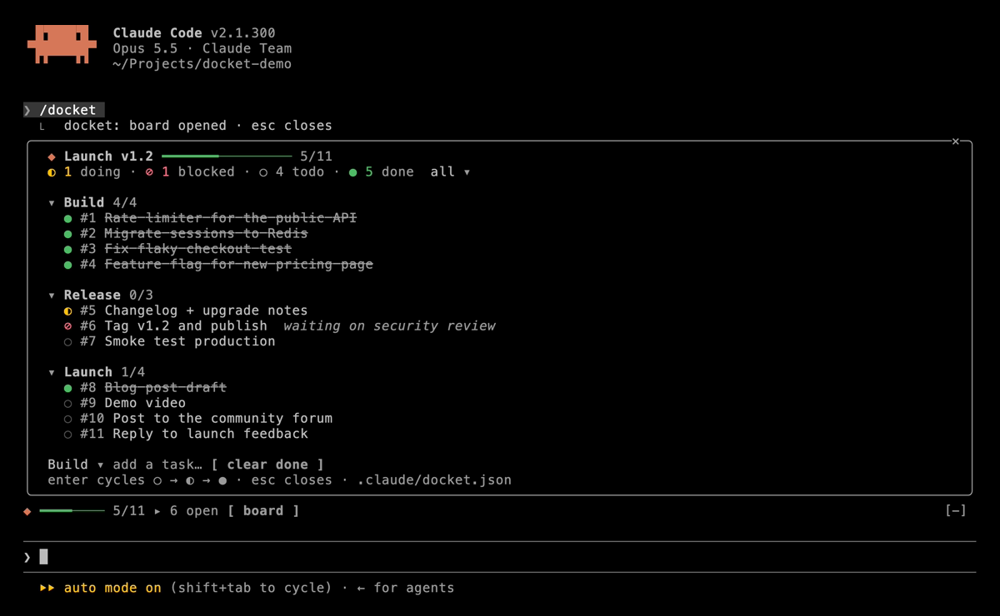

<div align="center">

# ◆ docket

**A minimal task board that lives inside Claude Code.**

You see what Claude is working on — above the prompt, all the time.<br>
Claude keeps it current. It survives crashes, restarts and new sessions.

[](LICENSE)




</div>

---

## Why

Long agent sessions lose the plot. The plan lives in a message forty screens up, the
terminal crashes, and the next session starts from nothing. **docket** puts the plan where
you look anyway — right above the prompt — and keeps it in a plain JSON file in your
project, so it outlives any one session.

## What it does

| | |
| --- | --- |
| **Band above the prompt** | Progress bar, the item in progress (◐), anything blocked (⊘), what is next (○). Up to six rows, then `+N more`. |
| **Fold it** | `/dk` folds the band to a single line and back. No model call, instant. |
| **Board pane** | `/docket` opens the whole board: lists you can fold, an `all` / `open` filter, Enter cycles ○ → ◐ → ●, add a task inline, clear done. |
| **A tool Claude uses** | Claude gets a `docket` tool (`view`, `plan`, `add`, `update`, `remove`, `clear_done`) and is told to plan multi-step work on the board and tick it off as it goes. |
| **Crash-proof** | The board is `.claude/docket.json` in your project. Close the terminal, come back tomorrow — it is still there, and Claude reads it before resuming. |
| **Plays well with other mods** | Draws on top of whatever other bands draw, never instead of them. While the board is open the band shrinks to one line. |
| **Hand-editable** | Edit the JSON yourself; the band picks it up within 1.5 s. A broken edit never wipes the board — the last good one stays on screen with the parse error under it. |
| **Native todos, mirrored** | Where Claude Code's own todo list runs, its items are mirrored into a `Session` list. |

<table>
<tr>
<td width="50%"><br><sub><b>The band</b> — always above the prompt</sub></td>
<td width="50%"><br><sub><b>Folded</b> — <code>/dk</code>, one line</sub></td>
</tr>
<tr>
<td colspan="2"><br><sub><b>The board</b> — <code>/docket</code></sub></td>
</tr>
</table>

## Install

At the prompt of a Claude Code terminal session:

```
/plugin install docket --marketplace michalstrnadel/claude-docket
```

or from a shell:

```bash
claude plugin install docket --marketplace michalstrnadel/claude-docket
```

Pick the **user** scope and it runs in every project. Requires a Claude Code build with
mods (function hooks), 2.1.300 or newer.

## Use it

Just work. When a task has more than two steps, Claude plans it on the board, marks the
current item ◐ and ticks items ● as they are verified. You can also ask directly:

> *"Put the release checklist on the docket."*
> *"What's left on the docket?"*
> *"Mark #4 blocked — waiting on review."*

| Command | Does |
| --- | --- |
| `/docket` | Open the board pane (Esc closes it). |
| `/dk` | Fold or unfold the band. |
| `ctrl+x tab` | Focus the band; Enter on the summary row folds it too. |
| `ctrl+x ctrl+a` | Claude Code's own: hide or show everything above the prompt. |

## The file

```jsonc
// .claude/docket.json
{
  "version": 1,
  "title": "Tasks",
  "nextId": 4,
  "lists": [
    {
      "name": "Release",
      "items": [
        { "id": 1, "title": "Write changelog", "status": "done", "updated": "…" },
        { "id": 2, "title": "Tag v1.2", "status": "doing", "note": "waiting on CI", "updated": "…" },
        { "id": 3, "title": "Announce", "status": "todo", "updated": "…" }
      ]
    }
  ]
}
```

Statuses: `todo` ○ · `doing` ◐ · `done` ● · `blocked` ⊘. Ids are never reused.

**Commit it or ignore it.** Commit `.claude/docket.json` to share the board with your team;
add it to `.gitignore` to keep it personal.

## How it works

docket is a Claude Code **mod**: one TypeScript hooks module, no server, no dependencies.

- `ui.render` on `AbovePrompt` draws the band; on `Pane` the board.
- `$.tool.register` gives Claude the `docket` tool, served by a `tool.call` hook.
- `prompt.compose` adds a short section to the system prompt so a fresh session knows the
  board exists. It is frozen per session, so it does not break prompt caching.
  *(Organizations that manage Claude Code run `prompt.compose` only for managed plugins —
  there the tool description carries the same instruction.)*
- The board model (`hooks/board.ts`) is pure functions over an immutable board — every
  rule is unit-tested, and a failed write never leaves state half-changed.

## Develop

```bash
git clone https://github.com/michalstrnadel/claude-docket
claude --plugin-dir ./claude-docket     # run it, hot-reloading on save
claude plugin validate ./claude-docket  # what the engine would refuse
claude plugin test ./claude-docket      # unit tests
vhs scripts/demo.tape                   # re-record docs/demo.gif and the screenshots
```

Issues and pull requests welcome.

## License

[MIT](LICENSE) © Michal Strnadel
